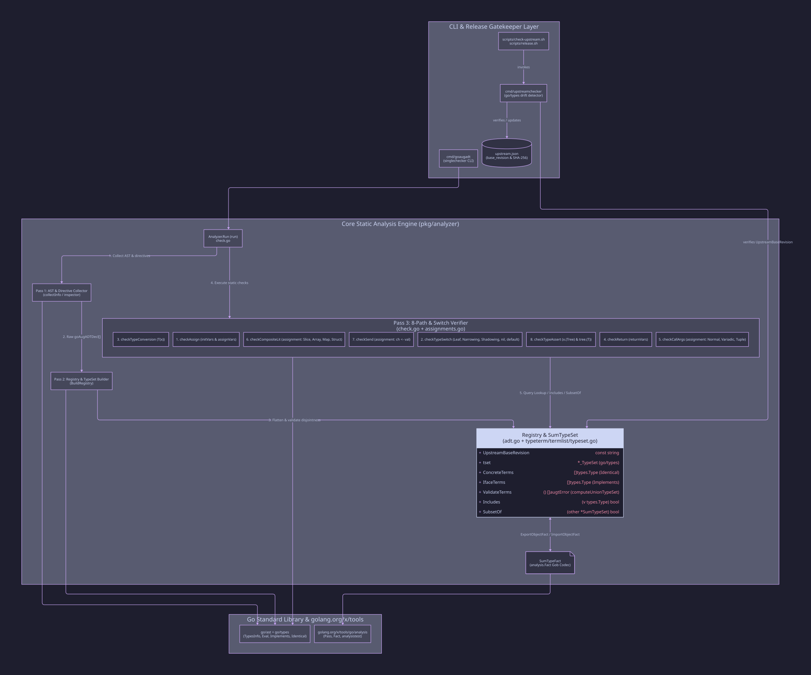
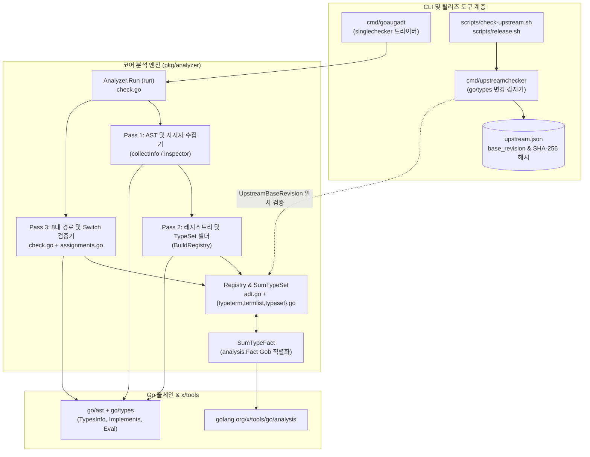
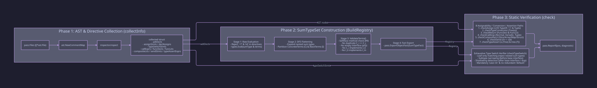
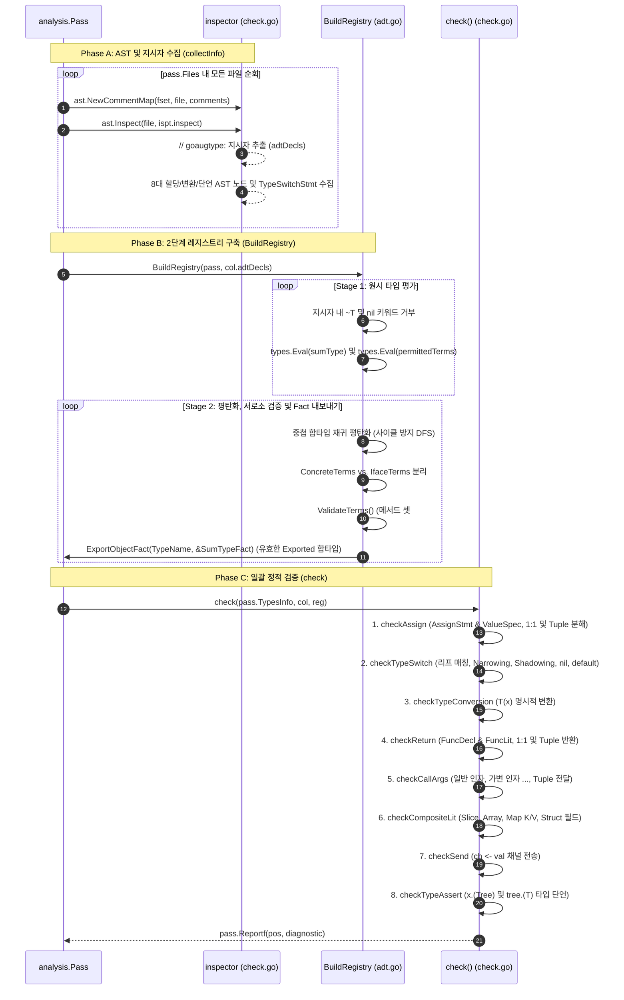
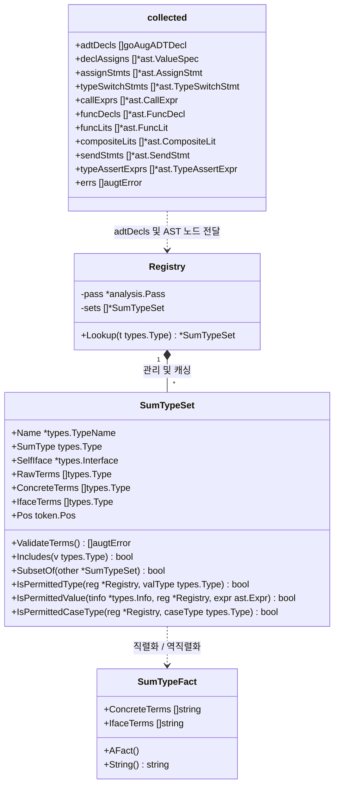
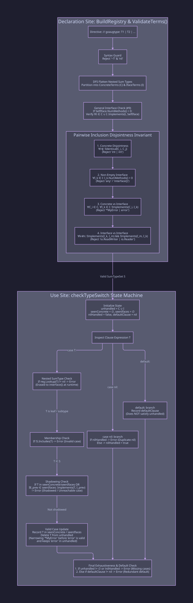
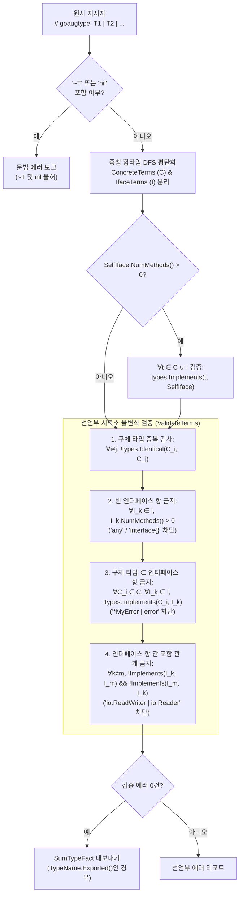
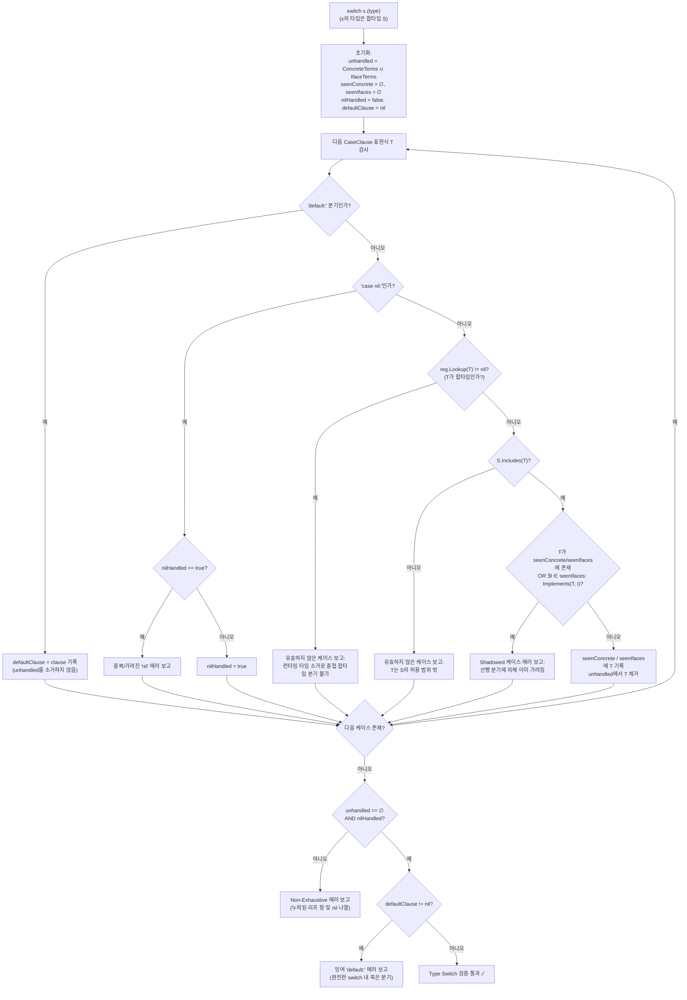
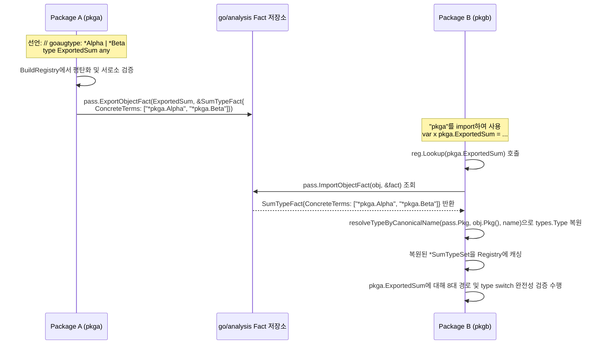
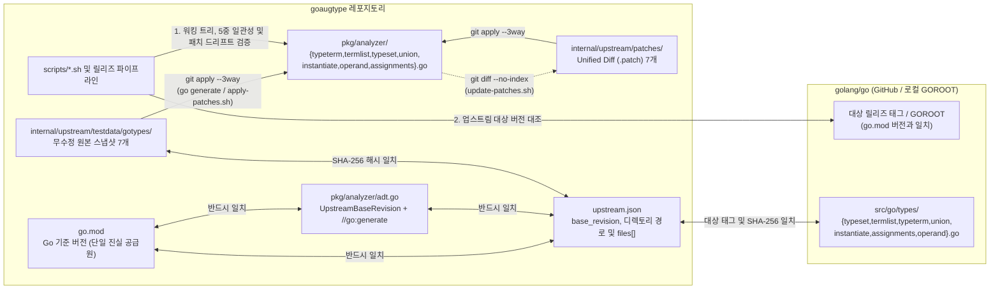

# `goaugtype` 아키텍처 개요 (Architecture Overview)

본 문서는 `goaugtype`의 전체 아키텍처와 큰 그림을 한눈에 파악할 수 있도록 **시스템 토폴로지, 2-Pass 정적 분석 파이프라인, `SumTypeSet` 핵심 데이터 모델, 선언부 서로소 검증 알고리즘, `type switch` 상태 머신, 패키지 간 `analysis.Fact` 전파, 그리고 업스트림 동기화 체계**를 시각적 다이어그램과 함께 설명합니다.

[golang/go#57644](https://github.com/golang/go/issues/57644)에 기반한 상세 언어 스펙 및 설계 근거는 [DESIGN.ko.md](./DESIGN.ko.md) ([DESIGN.md](./DESIGN.md))를 참고하십시오.

---

## 1. 시스템 컨텍스트 및 컴포넌트 토폴로지

`goaugtype`은 크게 3개의 계층으로 구성됩니다:

1. **CLI 및 드라이버 계층 (`cmd/goaugadt`)**: `golang.org/x/tools/go/analysis/singlechecker`를 통해 독립 실행형 린터 CLI 및 외부 린터 연동을 제공합니다.
2. **코어 정적 분석 엔진 (`pkg/analyzer`)**: AST/주석 수집, `SumTypeSet` 타입 셋 구성, 8가지 할당/변환/단언 경로 및 `type switch` 완전성 검증을 수행합니다 ([`adt.go`](../pkg/analyzer/adt.go), [`check.go`](../pkg/analyzer/check.go) 및 `go/types`에서 1:1로 포팅/생성된 7개 파일 [`typeterm.go`](../pkg/analyzer/typeterm.go), [`termlist.go`](../pkg/analyzer/termlist.go), [`typeset.go`](../pkg/analyzer/typeset.go), [`union.go`](../pkg/analyzer/union.go), [`instantiate.go`](../pkg/analyzer/instantiate.go), [`operand.go`](../pkg/analyzer/operand.go), [`assignments.go`](../pkg/analyzer/assignments.go)).
3. **업스트림 스냅샷·패치 파이프라인 및 릴리즈 게이트키퍼 (`cmd/upstreamchecker`, `internal/upstream/`, `scripts/`, `upstream.json`)**: `src/go/types` 원본 7개 파일을 [`internal/upstream/testdata/gotypes/`](../internal/upstream/testdata/gotypes)에 무수정 보관하고, [`internal/upstream/patches/`](../internal/upstream/patches)의 패치를 `go generate ./...` 또는 `./scripts/apply-patches.sh`로 적용하며, `go.mod` ↔ `UpstreamBaseRevision` ↔ `upstream.json` ↔ 원본 스냅샷 + 패치 ↔ 업스트림 `golang/go`의 5중 일관성을 검증합니다.

*원본 소스: [`docs/diagrams/architecture-topology.d2`](./diagrams/architecture-topology.d2)*

---

## 2. 2-Pass 정적 분석 파이프라인 (`Analyzer.Run`)

Go 언어에서는 타입 선언이 이를 사용하는 함수보다 파일 하단에 위치하거나 패키지 내 다른 파일에 흩어져 있을 수 있습니다. 따라서 `goaugtype`은 **Pass 1(AST 및 주석 수집)**과 **Pass 2(`Registry` 빌드 및 평탄화)**, 그리고 **Pass 3(일괄 정적 검증)**으로 파이프라인을 분리하여 선언 순서와 무관하게 중첩 합타입을 처리합니다.

*원본 소스: [`docs/diagrams/analysis-pipeline.d2`](./diagrams/analysis-pipeline.d2)*

---

## 3. 핵심 데이터 모델 (`pkg/analyzer/adt.go`)

표준 라이브러리의 `go/types.Union`은 메서드가 있는 인터페이스(예: `error`)가 유니온에 들어오면 메서드를 무시하고 `.terms`(`allTermlist = 𝓤`)만 합집합하여 타입 셋 전체가 `any`($\mathcal{U}$)로 폭발하는 문제가 있습니다.

이를 방지하기 위해 `SumTypeSet`은 평탄화된 리프 항들을 **`ConcreteTerms`(구체 타입 → `types.Identical` 비교)**와 **`IfaceTerms`(비어 있지 않은 일반 인터페이스 → `types.Implements` 비교)**로 이원화하여 관리합니다:

---

## 4. 선언부 검증 및 서로소 불변식 (`ValidateTerms`)

`BuildRegistry`가 중첩 합타입을 리프 항으로 평탄화한 뒤, `ValidateTerms()`는 `#57644`의 일반 인터페이스 메서드 구현 여부와 **쌍별 포함 서로소(Pairwise Inclusion Disjointness)** 4대 조건을 검증합니다:

*원본 소스: [`docs/diagrams/typeset-and-switch.d2`](./diagrams/typeset-and-switch.d2)*

---

## 5. `type switch` 검증 상태 머신 (`checkTypeSwitch`)

Go 런타임에서는 합타입 인터페이스가 기저 메서드 셋(대부분 `interface{}`)으로 타입 소거(Type Erasure)되므로, `checkTypeSwitch`는 **평탄화된 리프 매칭만 허용**하고(중첩 합타입 분기 금지), 상위 인터페이스보다 앞에 오는 **하위 타입 특수화(Narrowing)**는 허용하되 뒤에 오는 **분기 가리움(Shadowing)**은 차단하며, **`case nil:` 필수** 및 **잉여 `default:` 금지**를 수행합니다:

---

## 6. `analysis.Fact` 기반 패키지 간(Cross-Package) 분석 흐름

외부 패키지(`pkga`)에 선언된 합타입을 `pkgb`에서 import할 때, `pkga`의 AST 주석은 `pkgb` 분석 시점에 존재하지 않습니다. `goaugtype`은 `SumTypeFact`를 통해 패키지 경계를 넘어 합타입 메타데이터를 전달합니다:

---

## 7. 업스트림(`go/types`) 스냅샷·패치 파이프라인 및 릴리즈 게이트키퍼

포팅된 7개의 `go/types` 파일들을 투명하게 유지보수하기 위해, `goaugtype`은 [`internal/upstream/testdata/gotypes/`](../internal/upstream/testdata/gotypes)에 무수정 원본 스냅샷을 보관하고 [`internal/upstream/patches/`](../internal/upstream/patches)에 Unified Diff 패치 파일을 관리합니다. `go.mod`의 `go` 버전이 기준 버전의 단일 진실 공급원(Single Source of Truth)으로 동작하며, `cmd/upstreamchecker`, `scripts/*.sh`, `scripts/release.sh`는 **`go.mod` ↔ 코드 상수(`UpstreamBaseRevision`) ↔ `upstream.json` ↔ 로컬 원본 스냅샷 + 패치 적용 결과물 ↔ 업스트림 Go 릴리즈**의 5중 무결성을 강제합니다:

| 업스트림 `golang/go` 원본 | 로컬 무수정 스냅샷 | 패치 파일 | 포팅/생성된 `pkg/analyzer` 대상 | 주요 역할 |
| :--- | :--- | :--- | :--- | :--- |
| `src/go/types/typeterm.go` | [`gotypes/typeterm.go`](../internal/upstream/testdata/gotypes/typeterm.go) | [`typeterm.patch`](../internal/upstream/patches/typeterm.patch) | [`pkg/analyzer/typeterm.go`](../pkg/analyzer/typeterm.go) | 단일 타입 항 집합 연산 (`includes`, `subsetOf`, `disjoint`, `union`, `intersect`) 및 일반 인터페이스 항 지원 |
| `src/go/types/termlist.go` | [`gotypes/termlist.go`](../internal/upstream/testdata/gotypes/termlist.go) | [`termlist.patch`](../internal/upstream/patches/termlist.patch) | [`pkg/analyzer/termlist.go`](../pkg/analyzer/termlist.go) | 정규화된 항 리스트 집합 대수 (`norm`, `includes`, `supersetOf`, `subsetOf`) |
| `src/go/types/typeset.go` | [`gotypes/typeset.go`](../internal/upstream/testdata/gotypes/typeset.go) | [`typeset.patch`](../internal/upstream/patches/typeset.patch) | [`pkg/analyzer/typeset.go`](../pkg/analyzer/typeset.go) | `_TypeSet` 구조체, 메서드 셋 조회 및 `computeInterfaceTypeSet` |
| `src/go/types/union.go` | [`gotypes/union.go`](../internal/upstream/testdata/gotypes/union.go) | [`union.patch`](../internal/upstream/patches/union.patch) | [`pkg/analyzer/union.go`](../pkg/analyzer/union.go) | 유니온 항 파싱(`parseTilde`), 쌍별 서로소 검사(`overlappingTerm`), 중첩 합타입 평탄화(`computeUnionTypeSet`) |
| `src/go/types/instantiate.go` | [`gotypes/instantiate.go`](../internal/upstream/testdata/gotypes/instantiate.go) | [`instantiate.patch`](../internal/upstream/patches/instantiate.patch) | [`pkg/analyzer/instantiate.go`](../pkg/analyzer/instantiate.go) | `implements` 검증 (합타입 메서드 셋 구현 + `_TypeSet` 포함/부분집합 판정) |
| `src/go/types/operand.go` | [`gotypes/operand.go`](../internal/upstream/testdata/gotypes/operand.go) | [`operand.patch`](../internal/upstream/patches/operand.patch) | [`pkg/analyzer/operand.go`](../pkg/analyzer/operand.go) | `operand` 표현 및 `Registry` 합타입 후킹이 적용된 `assignableTo` |
| `src/go/types/assignments.go` | [`gotypes/assignments.go`](../internal/upstream/testdata/gotypes/assignments.go) | [`assignments.patch`](../internal/upstream/patches/assignments.patch) | [`pkg/analyzer/assignments.go`](../pkg/analyzer/assignments.go) | 1:1 및 다중 반환 튜플(`unpackRecv`) 대입 검증 (`initVars`, `assignVars`, `returnVars`) |

