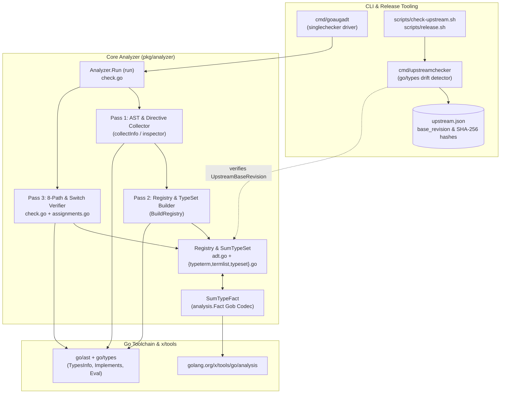
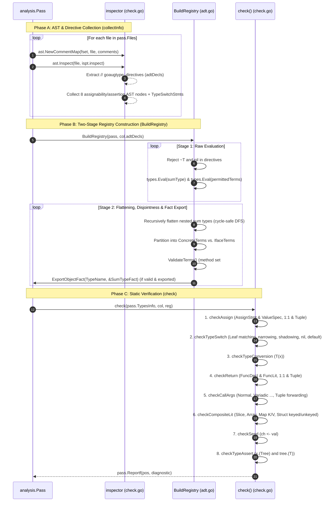
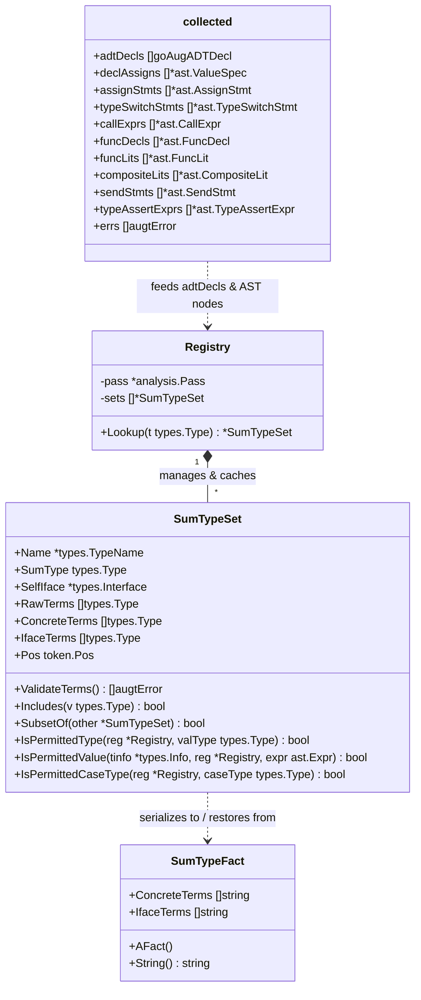
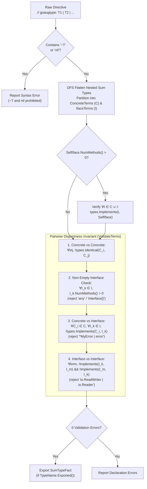
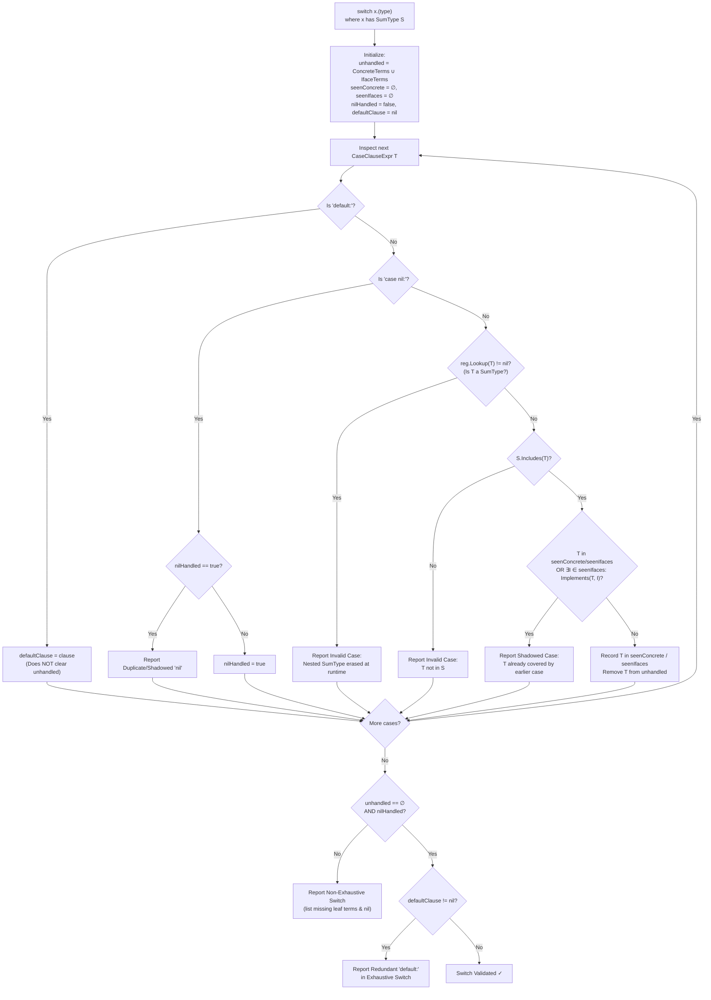
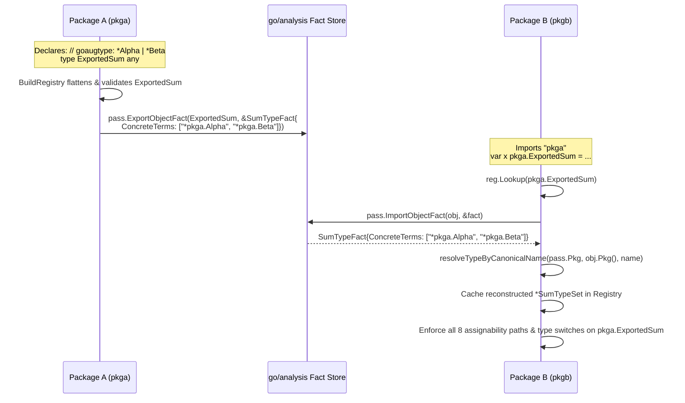
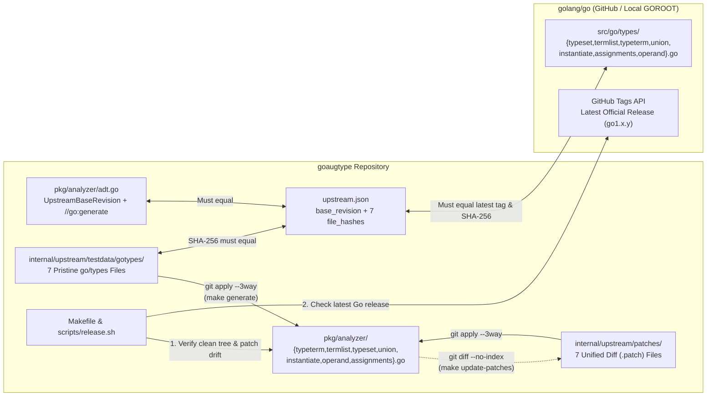

# `goaugtype` Architecture Overview

This document provides a high-level architectural view of `goaugtype`, illustrating its end-to-end analysis pipeline, core `SumTypeSet` data structures, cross-package `analysis.Fact` propagation, verification algorithms, and upstream synchronization workflow.

For detailed language specifications and rationale aligned with [golang/go#57644](https://github.com/golang/go/issues/57644), see [DESIGN.md](./DESIGN.md) ([DESIGN.ko.md](./DESIGN.ko.md)).

---

## 1. System Context & Component Topology

`goaugtype` is structured into three primary layers:
1. **CLI & Driver Layer (`cmd/goaugadt`)**: Wraps the analyzer with `golang.org/x/tools/go/analysis/singlechecker` for standalone CLI execution and standard linter integration.
2. **Core Analysis Engine (`pkg/analyzer`)**: Implements the two-pass AST/type-set static analyzer ([`adt.go`](../pkg/analyzer/adt.go), [`check.go`](../pkg/analyzer/check.go), and the 7 `go/types`-ported files [`typeterm.go`](../pkg/analyzer/typeterm.go), [`termlist.go`](../pkg/analyzer/termlist.go), [`typeset.go`](../pkg/analyzer/typeset.go), [`union.go`](../pkg/analyzer/union.go), [`instantiate.go`](../pkg/analyzer/instantiate.go), [`operand.go`](../pkg/analyzer/operand.go), and [`assignments.go`](../pkg/analyzer/assignments.go)).
3. **Upstream Synchronization, Patch Pipeline & Release Gatekeeper (`cmd/upstreamchecker`, `internal/upstream/`, `Makefile`, `scripts/`, `upstream.json`)**: Keeps pristine `src/go/types` snapshots in `internal/upstream/testdata/gotypes/`, applies unified diffs from `internal/upstream/patches/` via `go generate` (`make generate`), and enforces drift-free synchronization across Go releases.

*Source: [`docs/diagrams/architecture-topology.d2`](./docs/diagrams/architecture-topology.d2)*

---

## 2. Two-Pass Analysis Pipeline (`Analyzer.Run`)

Because Go allows types to be declared after the functions that reference them (or across multiple files in the same package), `goaugtype` decouples **AST & directive collection** from **type evaluation and verification**.

*Source: [`docs/diagrams/analysis-pipeline.d2`](./diagrams/analysis-pipeline.d2)*

---

## 3. Core Data Model (`pkg/analyzer/adt.go`)

Standard `go/types.Union` cannot represent sum types containing interfaces with methods (such as `error`) because `computeUnionTypeSet` in `go/types` discards interface methods in unions and collapses the union into `any` ($\mathcal{U}$).

To prevent this collapse while preserving `#57644` semantics, `SumTypeSet` partitions flattened leaf terms into `ConcreteTerms` and `IfaceTerms`:

---

## 4. Declaration-Site Validation & Disjoint Union Invariant

When `BuildRegistry` constructs a `SumTypeSet`, it flattens any nested sum types into leaf terms and runs `ValidateTerms()` to enforce both `#57644` general interface constraints and **Pairwise Inclusion Disjointness**:

*Source: [`docs/diagrams/typeset-and-switch.d2`](./diagrams/typeset-and-switch.d2)*

---

## 5. `type switch` Verification State Machine (`checkTypeSwitch`)

Because Go erases sum type interfaces at runtime to their underlying method set (often `interface{}`), `checkTypeSwitch` enforces **leaf-only matching**, supports **subtype narrowing** when ordered before a general interface term, detects **shadowed/unreachable cases**, requires **`case nil:`**, and rejects **redundant `default:` branches**:

---

## 6. Cross-Package Analysis via `analysis.Fact`

When package `pkgb` imports a sum type defined in `pkga`, `pkga`'s AST comments are no longer available. `goaugtype` bridges package boundaries using `SumTypeFact`:

---

## 7. Upstream `go/types` Synchronization, Patch Pipeline & Release Gatekeeper

To keep the 7 ported `go/types` files maintainable and verifiable, `goaugtype` stores unmodified upstream snapshots in [`internal/upstream/testdata/gotypes/`](../internal/upstream/testdata/gotypes) and unified diff patches in [`internal/upstream/patches/`](../internal/upstream/patches). `cmd/upstreamchecker`, `Makefile`, and `scripts/release.sh` enforce a 4-way consistency check (code constant ↔ `upstream.json` ↔ local pristine snapshots + patches ↔ latest upstream Go release):

| Upstream `golang/go` Source | Pristine Snapshot | Patch File | Ported `pkg/analyzer` Target | Purpose |
| :--- | :--- | :--- | :--- | :--- |
| `src/go/types/typeterm.go` | [`gotypes/typeterm.go`](../internal/upstream/testdata/gotypes/typeterm.go) | [`typeterm.patch`](../internal/upstream/patches/typeterm.patch) | [`pkg/analyzer/typeterm.go`](../pkg/analyzer/typeterm.go) | Single type term operations (`includes`, `subsetOf`, `disjoint`, `union`, `intersect`) with interface support |
| `src/go/types/termlist.go` | [`gotypes/termlist.go`](../internal/upstream/testdata/gotypes/termlist.go) | [`termlist.patch`](../internal/upstream/patches/termlist.patch) | [`pkg/analyzer/termlist.go`](../pkg/analyzer/termlist.go) | Normalized term list set algebra (`norm`, `includes`, `supersetOf`, `subsetOf`) |
| `src/go/types/typeset.go` | [`gotypes/typeset.go`](../internal/upstream/testdata/gotypes/typeset.go) | [`typeset.patch`](../internal/upstream/patches/typeset.patch) | [`pkg/analyzer/typeset.go`](../pkg/analyzer/typeset.go) | `_TypeSet` representation, method set lookup, and `computeInterfaceTypeSet` |
| `src/go/types/union.go` | [`gotypes/union.go`](../internal/upstream/testdata/gotypes/union.go) | [`union.patch`](../internal/upstream/patches/union.patch) | [`pkg/analyzer/union.go`](../pkg/analyzer/union.go) | Union term parsing (`parseTilde`), pairwise disjointness (`overlappingTerm`), and nested sum type flattening (`computeUnionTypeSet`) |
| `src/go/types/instantiate.go` | [`gotypes/instantiate.go`](../internal/upstream/testdata/gotypes/instantiate.go) | [`instantiate.patch`](../internal/upstream/patches/instantiate.patch) | [`pkg/analyzer/instantiate.go`](../pkg/analyzer/instantiate.go) | `implements` verification (method set satisfaction + `_TypeSet` inclusion/subset check) |
| `src/go/types/operand.go` | [`gotypes/operand.go`](../internal/upstream/testdata/gotypes/operand.go) | [`operand.patch`](../internal/upstream/patches/operand.patch) | [`pkg/analyzer/operand.go`](../pkg/analyzer/operand.go) | `operand` representation and `assignableTo` with `Registry` sum type hook |
| `src/go/types/assignments.go` | [`gotypes/assignments.go`](../internal/upstream/testdata/gotypes/assignments.go) | [`assignments.patch`](../internal/upstream/patches/assignments.patch) | [`pkg/analyzer/assignments.go`](../pkg/analyzer/assignments.go) | 1:1 and multi-value tuple (`unpackRecv`) assignment verification (`initVars`, `assignVars`, `returnVars`) |

